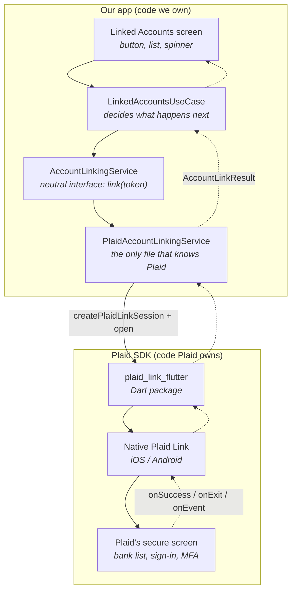
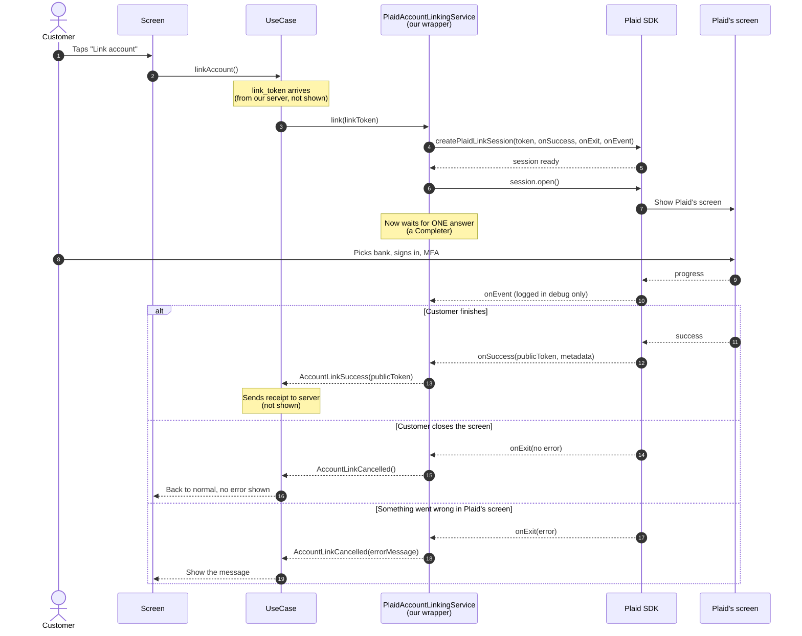
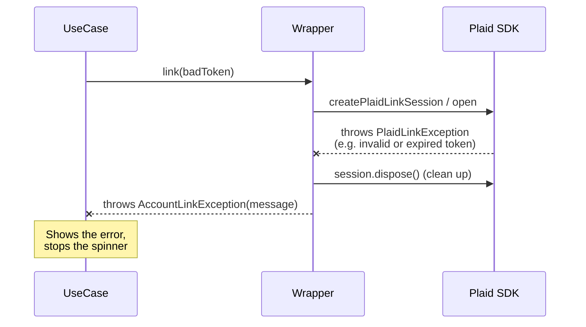

# Our App and the Plaid Flutter SDK

*This page covers only the conversation between **our app** and **the Plaid SDK** inside it. Servers are left out on purpose: here the link token just "arrives", and the receipt just "leaves".*

---

## The one-sentence version

Our app gives the SDK a **ticket** (link_token). The SDK shows Plaid's screen and later hands back exactly one answer: **"done, here's the receipt"** (public_token) or **"customer left"** (with or without an error).

---

## Who's who inside the phone

**The key boundary:** only `PlaidAccountLinkingService` talks to the SDK. Everything above it speaks our own neutral language (`AccountLinkSuccess`, `AccountLinkCancelled`). To replace Plaid, you replace that one box.

---

## The conversation, step by step

### In plain words

1. **The customer taps "Link account".**
2. **The screen tells the use case** to start linking.
3. A **link_token** is already in hand (our server provided it).
4. **The use case asks our wrapper** to link with that token. It doesn't know or care that Plaid is underneath.
5. **The wrapper creates a Plaid session.** It hands the SDK the token plus three "call me back" functions: one for success, one for exit, one for progress events.
6. **The SDK confirms** the session is ready.
7. **The wrapper says "open".**
8. **Plaid's screen slides up.** From here on, the customer is inside Plaid's UI, not ours. Our app can't see what they type.
9. **The wrapper waits** for exactly one final answer. A `Completer` makes sure only the first answer counts, even if the SDK calls back twice.
10. **The customer** picks their bank and signs in.
11. **While they do, the SDK sends progress events** like "selected institution" or "submitted credentials". We only log these in debug builds. They're useful for analytics or troubleshooting later.
12. **Then one of three things happens:**
    - **Success:** the SDK calls `onSuccess` with the public_token. The wrapper turns it into `AccountLinkSuccess`.
    - **Customer closed it:** `onExit` with no error. The wrapper returns `AccountLinkCancelled()`, and the app quietly goes back to normal. Closing isn't a failure.
    - **Error inside Plaid's flow** (bank down, wrong password too many times…): `onExit` with an error. The wrapper picks the friendliest message (`displayMessage` first, then `errorMessage`) and returns `AccountLinkCancelled(errorMessage: …)`.

---

## When the screen can't even open

This happens **before** the customer sees anything, usually because the token is invalid or expired (they last 4 hours). The wrapper cleans up the half-made session and converts Plaid's error into our own `AccountLinkException`. The use case never needs to import anything from Plaid.

---

## Translation table: Plaid's words → our words

| What the SDK says | What our wrapper returns | What the customer sees |
|---|---|---|
| `onSuccess(publicToken, …)` | `AccountLinkSuccess(publicToken)` | Spinner, then new account in the list |
| `onExit(error: null)` | `AccountLinkCancelled()` | Nothing, back where they were |
| `onExit(error: LinkError)` | `AccountLinkCancelled(errorMessage)` | The error message |
| `onEvent(LinkEvent)` | *(nothing, debug log only)* | Nothing |
| throws `PlaidLinkException` | throws `AccountLinkException` | The error message |

---

## What the app does **not** do

- **It doesn't talk to Plaid's servers.** The SDK does that internally, inside Plaid's screen.
- **It doesn't see the customer's bank password.** That's typed into Plaid's screen.
- **It doesn't keep the public_token.** It's passed on immediately.
- **It doesn't create the link_token.** Our server does that, because it needs secret keys.
- **It doesn't unlink accounts through the SDK.** The SDK has no unlink feature; that's a server call.

---

## Where it lives in the code

| Piece | File |
|---|---|
| Screen | `lib/linked_accounts/ui/linked_accounts_screen.dart` |
| Use case | `lib/linked_accounts/bloc/linked_accounts_use_case.dart` |
| Neutral interface + results | `lib/core/account_linking/account_linking_service.dart` |
| Plaid wrapper (only Plaid import) | `lib/core/account_linking/plaid_account_linking_service.dart` |
| Where Plaid is chosen | `lib/core/locator.dart` → `accountLinkingService` |
| Tests for the wrapper (fake SDK) | `test/core/account_linking/plaid_account_linking_service_test.dart` |
