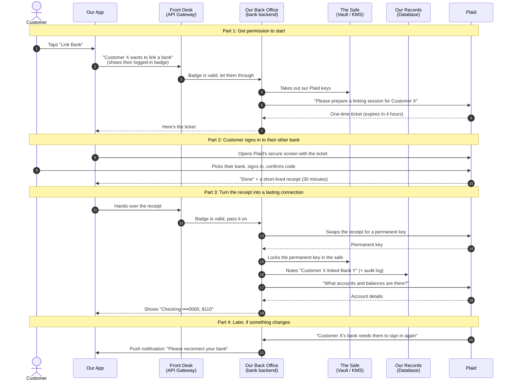

# Linking an External Bank Account: How It Works

*A walkthrough for everyone: product, business, compliance, support and engineering.*

---

## The one-sentence version

A customer can connect an account they hold at **another bank** to our app. They sign in to that other bank **inside Plaid's secure screen**, not ours, so **we never see their password for that bank**. From then on we can show the account and its balance.

---

## Who is involved

Think of it like a building with a front desk and a vault:

| Who | Plain-language role | In tech terms |
|---|---|---|
| **The customer** | The person linking their other bank | User |
| **Our app** | The phone app the customer is holding | Flutter mobile app |
| **Front desk** | Checks the customer's ID badge before anyone gets in | API Gateway |
| **Our bank's back office** | Our own system that does the real work with Plaid | Linked-Accounts Service (bank backend) |
| **The safe** | Where we lock away keys and secrets | Vault / KMS |
| **Our records** | Where we remember which accounts are linked | Database |
| **Plaid** | A trusted go-between that talks to thousands of banks | Plaid API + Plaid Link screen |
| **The other bank** | Where the customer's account actually lives | Customer's external bank |

---

## The picture

---

## Step by step, in plain words

### Part 1: Getting permission to start (steps 1–7)

> **"First, we make sure it's really our customer, and we ask Plaid to get ready."**

1. **The customer taps "Link Bank"** in our app.
2. **The app goes to the front desk.** The customer is already logged in to our app, so the app shows their badge (a login token).
3. **The front desk checks the badge.** If it's fake or expired, the request stops here. It also blocks anyone trying too many times.
4. **Our back office opens the safe** and takes out the keys we use to talk to Plaid. These keys **never go on the phone**. If they did, anyone could pull them out of the app.
5. **Our back office asks Plaid** to set up a linking session for this specific customer.
6. **Plaid hands back a one-time ticket.** It's only good for a few hours and only for this one session.
7. **The ticket goes back to the app.**

> 💬 *Why not let the app talk to Plaid directly?* Because that would mean putting our secret Plaid keys inside every phone. Keeping them in our back office is like keeping the master key in the bank, not handing a copy to every visitor.

---

### Part 2: The customer signs in to their other bank (steps 8–10)

> **"This is the part the customer sees. And it's the part where we deliberately look away."**

8. **The app opens Plaid's secure screen** using the ticket.
9. **The customer chooses their bank and signs in** with that bank's username, password and any security code. This all happens **between the customer, Plaid and their bank**.
10. **Plaid tells the app "done"** and gives it a **receipt**. The receipt is only valid for **30 minutes** and can be used **once**.

> 💬 *Do we ever see their other bank's password?* **No.** That's the main point of using Plaid. It lowers our risk and our compliance burden, and customers tend to trust it more.

---

### Part 3: Turning the receipt into a lasting connection (steps 11–19)

> **"The receipt is short-lived on purpose. We swap it for a permanent key, and that key never leaves our building."**

11. **The app hands the receipt to the front desk.** The badge is checked again.
12. **Front desk passes it to our back office.**
13. **Our back office swaps the receipt with Plaid** for a **permanent key** for that customer's bank connection.
14. **Plaid returns the permanent key.**
15. **We lock the permanent key in the safe.** It's encrypted, and it is **never sent to the phone**.
16. **We record that it happened**: which customer linked which bank, and when. This audit trail matters for compliance, disputes and support.
17. **We ask Plaid what accounts are there**, along with their balances.
18. **Plaid sends back the account details.**
19. **The app shows only what the customer needs to see**, for example "Checking ••••0000". Full account numbers stay on our side.

> 💬 *Why a short receipt and then a permanent key?* If someone stole the receipt from the phone, it would be useless within minutes, and useless anyway once we've swapped it. The valuable key only ever lives in our back office.

---

### Part 4: Later on (steps 20–21)

> **"Connections don't last forever. Plaid lets us know when one needs attention."**

20. **Plaid sends us a message** when something changes. For example, the customer changed their password at their other bank, or that bank wants them to confirm again. We check that the message really came from Plaid before acting on it.
21. **We nudge the customer** with a notification: "Please reconnect your bank." They go through a short version of Part 2 again.

---

## What this means for each team

| Team | What to take away |
|---|---|
| **Product / Business** | The customer can link most US banks in about a minute without leaving our app. |
| **Compliance / Risk** | We never handle other banks' passwords. Every link is logged. Secrets are kept in a vault. |
| **Customer Support** | "Please reconnect your bank" is normal and expected. It's usually because the customer changed their password at the other bank. |
| **Security** | Secret keys and permanent keys never reach the phone. Every request is checked at the front desk. |
| **Engineering** | The app side already exists in this repo. The back-office side (Parts 1, 3 and 4) is built by the backend team. See `PLAID_INTEGRATION.md` section 8. |

---

## Glossary

| Plain word used here | Official term |
|---|---|
| Badge | User session token (JWT) |
| One-time ticket | `link_token` (lasts 4 hours) |
| Receipt | `public_token` (lasts 30 minutes, single use) |
| Permanent key | `access_token` (server only) |
| Front desk | API Gateway |
| The safe | Vault / Key Management Service (KMS) |
| Plaid's secure screen | Plaid Link |
| Message from Plaid | Webhook |

---

## Today vs. production

In this sample app, a small **practice server** (`tool/plaid_server`) stands in for the front desk, back office and safe so developers can try it out. **It is not meant for real customers.** In production, all of that is replaced by the bank's real backend, as shown above.
